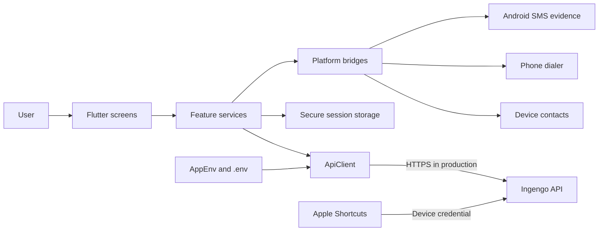
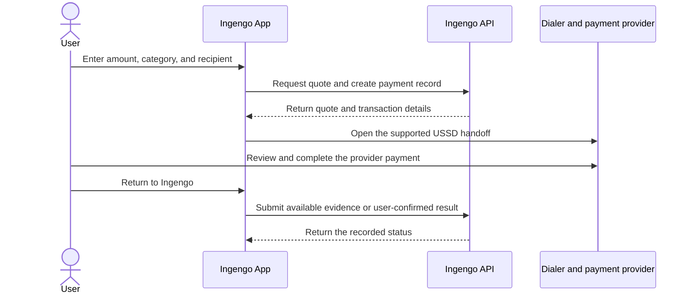
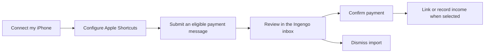

# Ingengo App

**The open-source Flutter client for Ingengo payments, income, and financial-message review.**

[Backend repository](https://github.com/nexcoderw/ingengo-api) ·
[Live API reference](https://ingengo-api.nexcode.africa/api/v1/docs) ·
[Contributing](CONTRIBUTING.md) · [Security](SECURITY.md) · [MIT License](LICENSE)

Ingengo helps people in Rwanda organize payment and income records. The app
guides users through Send Money, hands eligible transfers off to the phone's
dialer, and keeps payment evidence and income records available for review.
The [Ingengo API](https://github.com/nexcoderw/ingengo-api) handles
authentication and stores records. Payment providers handle the movement of funds.

## Contents

- [Features](#features)
- [Architecture](#architecture)
- [Payment flows](#payment-flows)
- [Getting started](#getting-started)
- [Client configuration](#client-configuration)
- [Platform support](#platform-support)
- [Testing and builds](#testing-and-builds)
- [Security and privacy](#security-and-privacy)
- [Project history](#project-history)
- [Troubleshooting](#troubleshooting)
- [Contributing](#contributing)
- [Authors and license](#authors-and-license)

## Features

| Area | What the app supports |
| --- | --- |
| Onboarding and sign-in | Onboarding, email verification and password flows, Google sign-in, and session storage |
| Send Money | RWF amounts, recipient selection, payment categories, fee quotes, and mobile USSD handoff |
| History and insights | Sent and received payment records, transaction details, and spending summaries |
| Received payments and income | Manual received-payment recording, payment classification, and expected and received income |
| Payment messages | An inbox to review, confirm, or dismiss payments imported through Apple Shortcuts |
| Profile | Account details and account-deletion requests |

## Architecture

Features organize presentation, application logic, and data access.
`AppEnv` selects the API address, `ApiClient` provides shared HTTP behavior,
and `SecureStorageService` wraps Flutter secure storage for session data.
Platform-specific operations use native integrations such as Flutter method channels.



| Path | Responsibility |
| --- | --- |
| [`lib/app/`](lib/app/) | App entry, theme setup, and onboarding navigation |
| [`lib/core/`](lib/core/) | Environment, HTTP client, session storage, and shared styles and widgets |
| [`lib/features/`](lib/features/) | Auth, onboarding, payments, income, message imports, and profile |
| [`test/`](test/) | Widget, model, parser, and payment reconciliation tests |
| [`android/`](android/) and [`ios/`](ios/) | Native targets, signing configuration, and platform integration |
| [`assets/`](assets/) | Branding, icons, fonts, and third-party font license |

## Payment flows

### Send Money

Choose an amount, category, and recipient. Ingengo requests a quote and prepares
a payment record. When the mobile handoff is available, the user completes the
payment in the provider's flow. Ingengo records supported evidence or lets the
user confirm the outcome manually when prompted.



### iPhone payment messages

Open the payment-message inbox from **History**, then choose **Connect my
iPhone** to start the guided setup. Apple Shortcuts submits eligible messages
to the API. The app displays them for review under **To review**, **Added**,
or **Dismissed**. Confirmation can record a received payment and optionally
link it to income when applicable.



See the [API Shortcut rollout guide](https://github.com/nexcoderw/ingengo-api/blob/main/IPHONE_SHORTCUT_ROLLOUT.md)
for version, provider, and pilot details.

## Getting started

Install [Flutter](https://docs.flutter.dev/install) with a compatible Dart SDK.
The app declares `^3.10.4` in [pubspec.yaml](pubspec.yaml). Install the tools
for your target and use a development instance of the
[Ingengo API](https://github.com/nexcoderw/ingengo-api#readme) for backend work.

1. Clone the app and create its local configuration.

   ```bash
   git clone https://github.com/nexcoderw/ingengo-app.git
   cd ingengo-app
   cp -n .env.example .env
   ```

2. Set the API URLs and Google client IDs for your target. Flutter bundles
   the root `.env` as an asset, so it must exist before you build.
3. Check tooling, install dependencies, and select a target.

   ```bash
   flutter doctor
   flutter pub get
   flutter devices
   flutter run
   ```

   When several targets are connected, pass the device ID from `flutter devices`
   with `flutter run -d <device-id>`. For the web, use `flutter run -d chrome`.

## Client configuration

Use the checked-in [.env.example](.env.example) as a template. These settings
are public client configuration. A built app can reveal its bundled values.

| Setting | What to enter |
| --- | --- |
| `API_BASE_URL` | Native fallback URL. A local API on port 8000 can use `http://127.0.0.1:8000/api/v1` when reachable. |
| `API_BASE_URL_NATIVE` | Optional first-choice native override. |
| `API_BASE_URL_MOBILE` | Optional second-choice native URL. Use your development machine's LAN address on a physical device. |
| `API_BASE_URL_WEB` | Required web API URL. Allow the browser origin in the API's `CORS_ALLOWED_ORIGINS` and in Google OAuth when using Google sign-in. |
| `GOOGLE_SERVER_CLIENT_ID` | Server audience client ID for native Google sign-in. It must match an audience configured by the API. |
| `GOOGLE_CLIENT_ID` | Web OAuth client ID for browser sign-in. |
| `GOOGLE_IOS_CLIENT_ID` | Optional iOS OAuth client ID override. Use the registered iOS configuration and its matching URL scheme. |

Native URL precedence is `API_BASE_URL_NATIVE`, `API_BASE_URL_MOBILE`, then
`API_BASE_URL`. Replace the example mobile LAN address when using native local
development, since it takes precedence over the base URL. The Android emulator
maps loopback addresses to `10.0.2.2`. For an iOS simulator, use a Mac-local
API URL as the native override. Use `https://ingengo-api.nexcode.africa/api/v1`
for production client builds.

## Platform support

| Target | Development expectations |
| --- | --- |
| Android | Android SDK and emulator or phone. Reading SMS requires permission and is Android-specific. Test real provider handoff only on an authorized test device. |
| iOS | macOS, Xcode with the SDK for the checked-in app and extension targets, and an iOS simulator or iPhone. Apple Shortcuts and provider handoff need device verification. |
| Web | A compatible browser and an allowed origin. Native SMS and USSD flows are platform-gated. |
| macOS, Windows, Linux | Platform project files are present. Check plugins and target tooling before relying on a native feature on desktop. |

Check platform documentation when setting up a new machine.
[Flutter platform setup](https://docs.flutter.dev/install)

## Testing and builds

From the app directory, run:

```bash
flutter pub get
dart format --output=none --set-exit-if-changed lib test
flutter analyze
flutter test
```

For changes to native channels, permissions, Google sign-in, or payments, also
test the affected flow on the relevant device or simulator. Check denied
permissions, empty or failed requests, large text, and narrow screens when they
apply. Use synthetic records and a development API.

Build the target you intend to verify.

```bash
flutter build apk
flutter build ios --simulator
flutter build web
```

Signed Android and iOS distribution builds use platform signing configuration
managed by release maintainers.

## Security and privacy

- Send bearer tokens only to the configured API origin and use HTTPS in
  production. Store sessions through `SecureStorageService`.
- Put only public client settings in the bundled `.env`. Keep server secrets,
  signing files, and tokens out of app assets, logs, and screenshots.
- Preserve contacts permission and Android SMS permission boundaries. Keep
  provider evidence distinct from a result manually confirmed by a user.
- Redact phone numbers, payment references, balances, and message content in
  public issues and test evidence. Use the [security policy](SECURITY.md) to
  report vulnerabilities privately.

## Project history

| Change | What changed |
| --- | --- |
| Ingengo rebrand | The app moved from Budgetify branding to Ingengo and now points to the Ingengo API production hostname. |
| iOS simulator setup | The accessory extension entitlement filename was aligned with its Xcode signing settings. Local setup documents the required `.env` asset. |
| Payment-message inbox | The inbox gained clearer filters, a dedicated Shortcut setup card, and a matching phone-connection icon and button label. |
| Send Money categories | Airtime, Personal care, Travel, Savings, and Loan repayment joined the existing categories, bringing the picker to 16. The app and API use the same category identifiers. |
| Open-source workflow | The app follows the same branch, one-file commit, and PR handoff rules as the API, with app-specific setup, contribution, and security guidance. |

## Troubleshooting

| Symptom | Where to look |
| --- | --- |
| Flutter reports `No file or variants found for asset: .env` | Copy `.env.example` to `.env` at the app root before building. |
| The app opens but requests fail | Check the effective URL for that platform, the API process, and reachability from the target device. For web, check the browser origin and API CORS. |
| Google sign-in fails | Check the client ID for your target, the backend audience allowlist, and the iOS URL scheme or web authorized origin where applicable. |
| The iOS build cannot find `Ingengo.entitlements` | Use a revision containing the renamed [extension entitlements file](ios/Ingengo/Ingengo.entitlements) and check that the Xcode target points to it. |
| An Apple Shortcut still calls the retired hostname | Follow the current iPhone setup flow and update the automation's API endpoint. |

## Contributing

First contributions are welcome. Start with the [contributor guide](CONTRIBUTING.md)
and [code of conduct](CODE_OF_CONDUCT.md). Good starting points include
improving a setup step, covering an error state in a widget test, and writing
a bug report with synthetic data.

Use the [issue chooser](https://github.com/nexcoderw/ingengo-app/issues/new/choose)
for ordinary bugs and feature requests.

## Authors and license

**Author** [KAJUGA Daniels](https://github.com/kajugadaniels)

Developed with **Nexcode Africa** and the
[Ingengo App contributors](https://github.com/nexcoderw/ingengo-app/graphs/contributors).

The project source is available under the [MIT License](LICENSE).
Bundled DM Sans fonts use the [SIL Open Font License 1.1](assets/fonts/dm_sans/OFL.txt).
Third-party dependencies, marks, and assets retain their respective terms.
